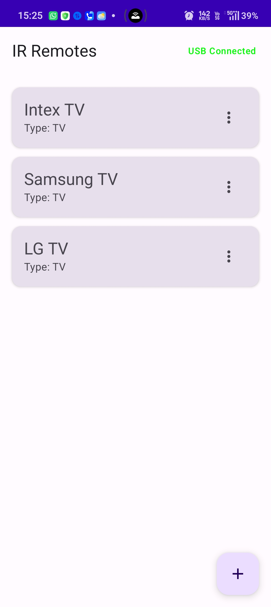
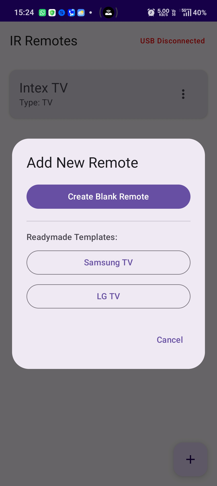
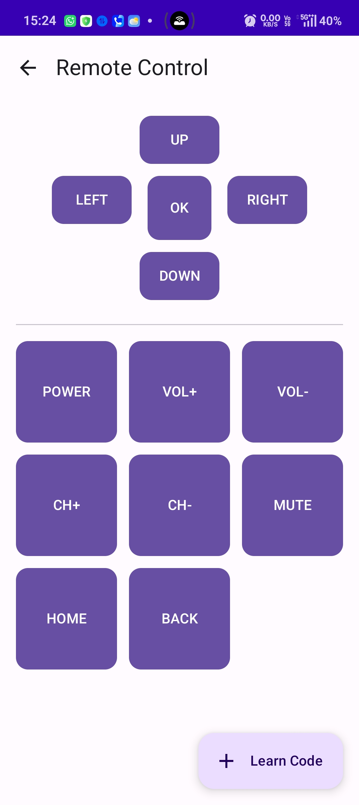
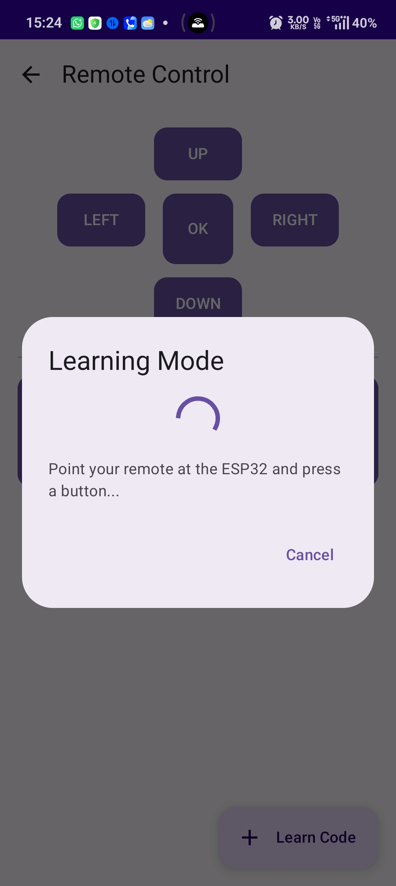
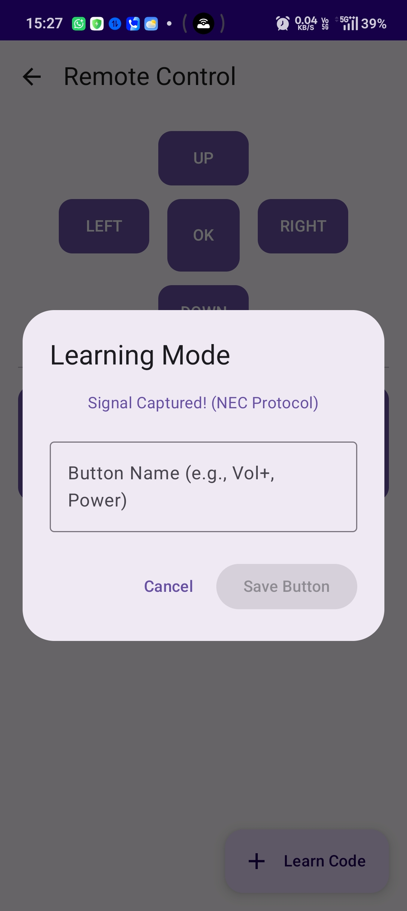

# USB-C IR Blaster & Learning Remote

A local-first, privacy-focused Android application and custom hardware module that transforms any Android smartphone into a universal learning infrared (IR) remote. It operates entirely offline over a physical USB-OTG Serial connection to an ESP32-S3, ensuring zero cloud dependency and zero latency.

## Features
*   **Hardware-Level Learning Mode:** Captures both standard NEC protocols and complex raw IR arrays (like AC remotes) using a TSOP38238 receiver.
*   **USB-OTG Serial Communication:** Uses the `mik3y/usb-serial-for-android` library at 115200 baud for instantaneous transmission.
*   **Offline First:** Built with Android Room Database to store all device profiles, button mappings, and raw hex codes locally on the device.
*   **Dynamic UI:** Add blank remotes, load readymade templates (Samsung, LG), and long-press buttons to rename or delete them.

## Screenshots

  
  
  
  
  

## Hardware Components
*   **Microcontroller:** ESP32-S3 Development Board (with USB-C)
*   **IR Receiver:** TSOP38238
*   **IR Transmitter:** 940 nm IR LED
*   **Transistor:** 2N2222A-1726 (NPN)
*   **Resistors:** 1 kΩ (for Transistor Base), 22 Ω (for IR LED current limiting)
*   **Capacitor:** 0.1 µF (104) ceramic capacitor
*   **Miscellaneous:** Breadboard, jumper wires, USB-C OTG cable

## Wiring & Connections

### 1. IR Transmitter Circuit
Connect the components according to the following wiring plan:
*   **ESP32 GPIO5** ➔ One end of the 1 kΩ resistor
*   **Other end of 1 kΩ resistor** ➔ Transistor base (B)
*   **Transistor emitter (E)** ➔ ESP32 GND
*   **Transistor collector (C)** ➔ IR LED cathode (-)
*   **IR LED anode (+)** ➔ One end of the 22 Ω resistor
*   **Other end of 22 Ω resistor** ➔ ESP32 3V3

### 2. IR Receiver Circuit
Use the following table to connect the receiver's functional pins:
*   **VS / VCC** ➔ ESP32 3V3 (Powers the receiver)
*   **GND** ➔ ESP32 GND (Ground)
*   **OUT** ➔ ESP32 GPIO4 (Sends the received pulse pattern to the ESP32)
*   *Note:* Place the 0.1 µF ceramic capacitor between the receiver's VS and GND connections, preferably close to the receiver to filter noise.

## Software Installation

### ESP32 Setup
1. Open `esp32-code/esp32_s3_code.ino` in the Arduino IDE.
2. Install the **IRremote** library via the Arduino Library Manager.
3. Select your ESP32-S3 board and flash the code.

### Android App Setup
1. Open the `app` folder in Android Studio.
2. Sync the project with Gradle files.
3. Build the APK (`Build > Build Bundle(s) / APK(s) > Build APK(s)`) and install it on your Android phone.

## Usage Guide
1. **Connect:** Plug the ESP32-S3 directly into your Android phone using a USB-C to USB-C cable (or OTG adapter).
2. **Permissions:** Android will prompt you to grant USB permissions to the app. Accept it. The app header will change to "USB Connected".
3. **Add a Remote:** Tap the `+` button. You can add a pre-configured template (like Samsung TV) or start a Blank Remote.
4. **Learn a Code:**
    * Open your blank remote and tap **Learn Code**.
    * Point your physical factory remote at the TSOP38238 receiver on the breadboard and press a button.
    * The app will detect the protocol (NEC or RAW), prompt you to name the button (e.g., "Power" or "Vol+"), and save it to the dashboard.
5. **Transmit:** Tap the newly created button on your screen to blast the IR signal to your appliance.
